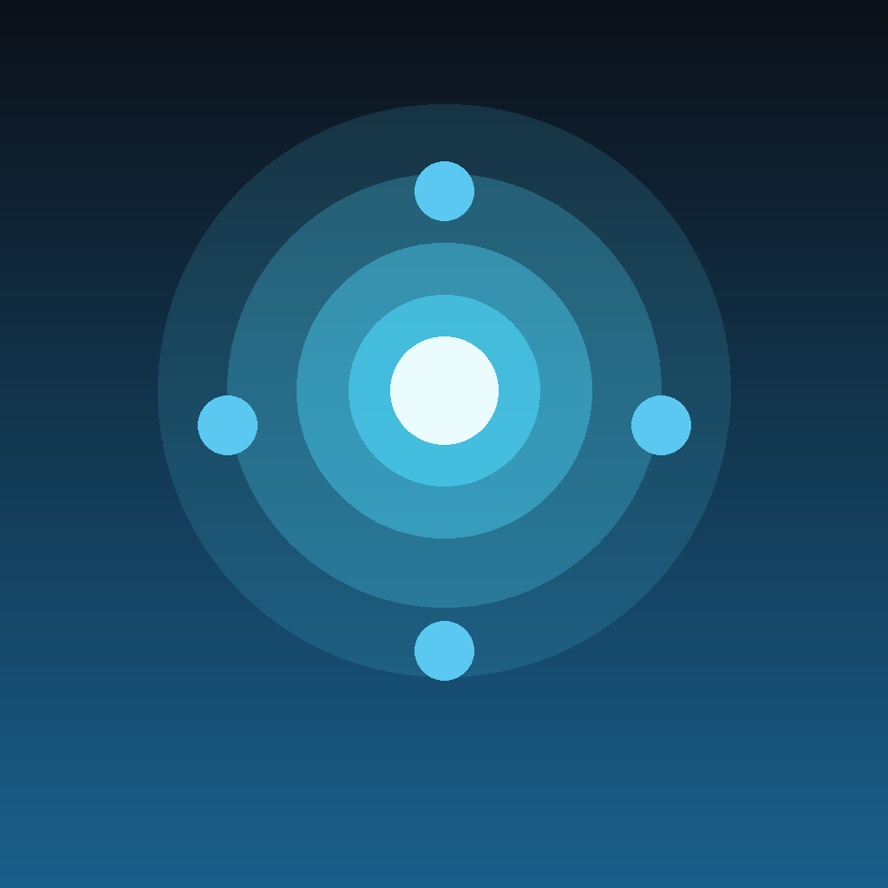

# TouchMapper iOS

把 iPhone 变成电脑的触摸板——**原样对接压缩包里那个 `虚拟多点触控.exe`**，不需要换电脑端。

这是 `虚拟多点触控板.apk`（Android）的 iOS 等价实现，协议逐字段对齐，连原版 Windows 程序即可用。



## 它做什么

```
 iPhone ──Wi-Fi──> ws://<电脑IP>:17890/touch ──> TouchMapper.exe ──> InjectTouchInput
 手指位置            JSON 文本帧                    Kestrel WebSocket     Win32 多点触控
```

- 手指按下的位置按比例映射到 Windows 桌面，以**真正的触摸事件**注入（不是鼠标模拟）
- 支持 10 指同时触摸
- 界面上那些「摇杆 / 技能 / 攻击 / 按键」贴纸只是位置提示，不会自己触发——真正发送的是你的手指位置，和 Android 版行为一致
- 支持布局预设保存 / 应用 / 重命名 / 删除

## 协议

完整规范见 [../PROTOCOL.md](../PROTOCOL.md)。核心就一包 JSON：

```json
{
  "type": "screen-touch",
  "phase": "down",
  "x": 0.3521,
  "y": 0.7714,
  "sequence": 1234,
  "contactId": 0,
  "screenWidth": 1179,
  "screenHeight": 2556
}
```

- `x` / `y` 是 **0..1 归一化坐标**
- `phase` 取 `down` / `move` / `up` / `cancel`，小写
- 端口 `17890`，路径 `/touch`

## 目录结构

```
TouchMapper/
├── Sources/
│   ├── TouchMapperApp.swift          入口（对应 MainActivity）
│   ├── Protocol/TouchPacket.swift     协议定义 + URL 构造
│   ├── Networking/TouchConnection.swift  WebSocket 客户端（对应 TouchChannel.kt）
│   ├── Touch/
│   │   ├── TouchSession.swift         坐标归一化 + contactId 池
│   │   └── MultiTouchCaptureView.swift 10 指触摸采集（UIView 层）
│   ├── Models/LayoutSticker.swift     贴纸模型 + 预设模型
│   └── Views/
│       ├── ConnectionView.swift       连接面板（对应 ConnectionPanel）
│       ├── FullScreenTouchView.swift  全屏触控页（对应 FullScreenTouchPanel）
│       ├── StickerLayer.swift         贴纸编辑层
│       └── PresetSheet.swift          布局预设管理
├── Info.plist                         含 NSLocalNetworkUsageDescription
└── Assets.xcassets                    AppIcon
```

## 关键实现点

| 点 | 做法 |
|---|---|
| 多点触摸 | SwiftUI 的 `DragGesture` 只给单指，所以底层用 `UIView` 重写 `touchesBegan/Moved/Ended/Cancelled`，通过 `UIViewRepresentable` 桥进 SwiftUI |
| 触点 ID | `ObjectIdentifier(UITouch)` 映射到 0~9 的槽位池，抬起后归还 |
| move 节流 | 60Hz 定时冲刷；队列里还压着未发的 move 就覆盖并计数丢弃——对应 Android 的「发送队列过载丢弃移动包」 |
| down/up/cancel | 绝不节流、绝不丢弃，立即发出 |
| 触点粘住 | 切后台 / 退出全屏时对残留触点补发 `cancel` |
| 本地网络权限 | `Info.plist` 里 `NSLocalNetworkUsageDescription` + `NSBonjourServices`，`NSAppTransportSecurity.NSAllowsLocalNetworking = true` 允许明文 `ws://` |

## 本地编译

```bash
# 需要 macOS + Xcode 15+
xcodebuild -project TouchMapper.xcodeproj \
  -scheme TouchMapper \
  -configuration Release \
  -sdk iphoneos \
  -destination 'generic/platform=iOS' \
  -archivePath build/TouchMapper.xcarchive \
  CODE_SIGNING_ALLOWED=NO \
  build archive
```

## 用 GitHub Actions 出 IPA

推上去就能跑，产物在 Actions 页面的 Artifacts 里：

1. 新建仓库，把这些文件按目录结构推上去
   ```bash
   git init
   git add ios/ .github/
   git commit -m "TouchMapper iOS"
   git branch -M main
   git remote add origin https://github.com/<你的用户名>/<仓库名>.git
   git push -u origin main
   ```
2. 打开仓库 → **Actions** → 左侧 **Build IPA** → 右侧 **Run workflow**
3. 跑完（约 3~5 分钟）下载 `TouchMapper-unsigned-ipa`

流水线做的事：

- `macos-14` + 最新 Xcode
- `xcodebuild archive` 全关签名（`CODE_SIGNING_ALLOWED=NO`）
- 把 `.app` 塞进 `Payload/` 打成 zip，改名 `.ipa`
- 校验 `CFBundleIdentifier`、算 SHA-256
- 上传 artifact（保留 30 天）

### 签名 / 安装

产物是**未签名 IPA**，iOS 不会直接装，需要重签一次：

| 方式 | 平台 | 说明 |
|---|---|---|
| **Sideloadly** | Windows / macOS | 拖入 IPA，填 Apple ID，自动签 7 天有效期 |
| **AltStore** | Windows / macOS | 走 AltServer，同样 7 天 |
| **Xcode** | macOS | 图形界面直接跑真机 |
| **自己签** | 任意 | 解包替换 `_CodeSignature`，`codesign -f -s "证书"` 后重打 zip |

有付费开发者账号（$99/年）的话，把证书和描述文件传成 repo Secrets，我可以在 workflow 里加 `-exportArchive` 那一段，直接出可装一年的 IPA。

## 用法

1. 电脑上双击 `虚拟多点触控.exe`，窗口显示「等待手机连接 · 端口 17890」
2. 电话和电脑连同一个 Wi-Fi
3. Windows 防火墙弹窗 → 允许**专用网络**
4. 在 Windows 上 `ipconfig` 查 Wi-Fi 适配器的 IPv4，比如 `192.168.1.23`
5. iOS App 里填这个地址，端口 17890，点「连接电脑」
6. 点「进入全屏触控」，把游戏/模拟器设为全屏、手机横竖方向和电脑一致
7. 需要改布局时打开「编辑按钮」，摆好位置再关掉

## 排查

| 症状 | 处理 |
|---|---|
| 连不上 | 同一 Wi-Fi？访客网络/客户端隔离？防火墙专用网络放行？地址是电脑的不是路由器的？ |
| 连上但游戏没反应 | 游戏/模拟器不接收 `InjectTouchInput` 注入，这是目标程序限制，不是客户端问题 |
| 位置偏 | 游戏没全屏 / 手机与电脑方向不一致 / 多显示器（虚拟桌面被整体拉伸） |
| 只认一根手指 | 确认没开「编辑按钮」——编辑模式下触摸被贴纸层接管 |
| 第一次没弹本地网络权限 | 设置 → 隐私与安全性 → 本地网络，重新打开本 App 的开关 |

## 与原程序的差异

| 项 | Android 原版 | 本 iOS 版 |
|---|---|---|
| 传输协议 | 完全一致 | 完全一致 |
| 摇杆模式 | 有（已废弃） | 不实现 |
| 多点上限 | 10 | 10 |
| move 节流 | 有 | 有（60Hz） |
| 断线重连 | 有 | 有（2 秒） |
| 布局预设 | 有 | 有 |
| 电脑端 | 需 `TouchMapper.exe` | 同 |
